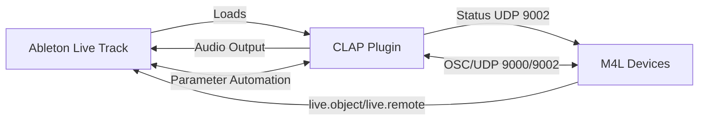
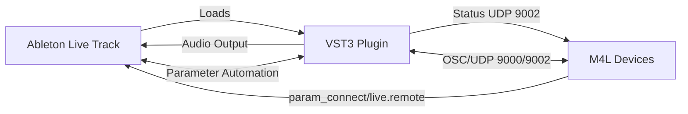
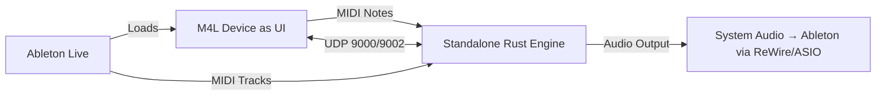

# Realistic Ableton Integration Options (Accurate Info)

## Clarifying Misconceptions

**CLAP ≠ M4L only**: CLAP is a **plugin format** (like VST/VST3/AU) that loads as a track instrument/effect in Ableton Live. You get audio output directly from the plugin.

**M4L ≠ scrapping Rust**: M4L devices can communicate with external Rust processes via UDP/OSC, and you can embed Rust audio engines in M4L using externals.

**VST3 license**: For development/testing, Steinberg provides free VST3 SDK. Commercial distribution requires license, but for your use case (personal Ableton integration), you can develop with it.

## Three Realistic Paths Forward

### Path 1: CLAP Plugin (Best Balance)

**Pros:**
- ✅ Native Ableton support (Live 11.3+)
- ✅ Audio output direct from plugin
- ✅ Parameter automation in Arrangement view
- ✅ MIT license options available
- ✅ M4L can control via Live API or UDP/OSC
- ✅ Modern, clean API

**Cons:**
- Requires building CLAP plugin (need to migrate from VST2)
- Need to learn CLAP API (similar complexity to VST3)

**Tech Stack Options:**
- `nice-plug` with CLAP export (ISC framework)
- `clap-clap` crate (MIT, beta)
- Manual CLAP with `clap-sys`

### Path 2: VST3 Plugin (Full Compatibility)

**Pros:**
- ✅ Universal DAW compatibility
- ✅ Full VST3 spec (sample-accurate automation, etc.)
- ✅ M4L `vst~` object + `param_connect` works great
- ✅ vst3 crate is now MIT licensed (Dec 2025)

**Cons:**
- VST3 SDK has some GPL components (but vst3 crate is MIT)
- Slightly more complex than CLAP

### Path 3: Hybrid M4L + UDP (Keep Current Arch)

**Pros:**
- ✅ Keep current UDP-based architecture
- ✅ Minimal changes to existing code
- ✅ M4L handles UI/display

**Cons:**
- ❌ Audio routing complexity (need ASIO/ReWire/JACK)
- ❌ No direct plugin automation
- ❌ Higher latency
- ❌ Feels "bolted on"

## Recommendation: CLAP with nice-plug

1. **Migrate VST2 → CLAP** using nice-plug
2. **Keep UDP bridge** for M4L <-> plugin communication (redundant but robust)
3. **Use Live API** in M4L for advanced control
4. **Maintain standalone** and VST2 as fallback options

## Immediate Next Steps

1. Add CLAP dependency to workspace
2. Create CLAP plugin using nice-plug framework
3. Port engine interface from VST2 to CLAP
4. Test in Ableton Live
5. Enhance M4L with Live API controls